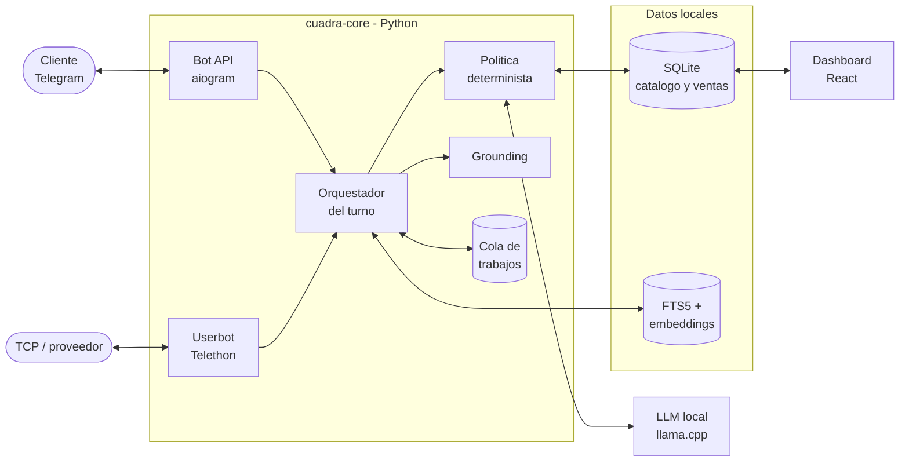
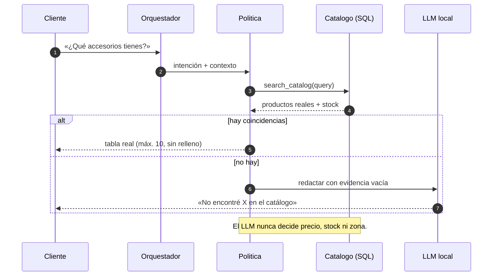
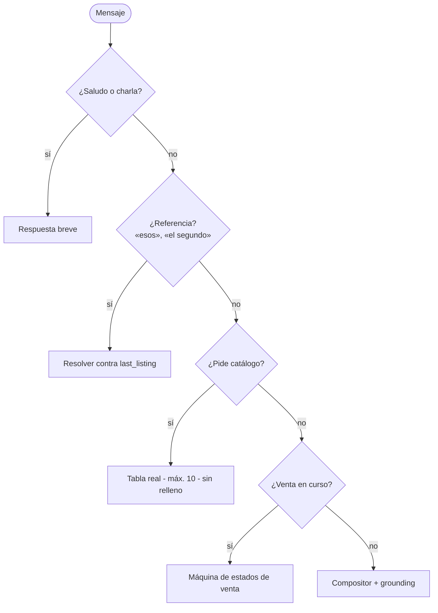

<p align="center">
  
</p>

<h1 align="center">Cuadra</h1>

<p align="center">
  <strong>El agente que atiende, cotiza y despacha por Telegram.</strong><br>
  Solo, offline y con datos reales del catálogo.
</p>

<p align="center">
  
  
  
</p>

<p align="center">
  
  
  
  
  
  
</p>

> [!NOTE]
> **Cuadra** es un agente de ventas para Telegram pensado para operar en un solo
> equipo Windows, sin nube y sin costo por token. El bot conversa, consulta el
> catálogo, cotiza, reserva y despacha el pedido al proveedor (TCP). El operador
> cierra el pago y cobra la comisión.

---

## ¿Qué es Cuadra?

Un puente entre un cliente que pregunta por WhatsApp/Telegram y un proveedor que
tiene el producto. El agente hace el trabajo repetitivo —responder, buscar,
cotizar, tomar datos y coordinar— y deja al humano la decisión comercial.

| Hace | No hace |
|---|---|
| Atiende y responde en segundos, 24/7 | No inventa precio, stock, zona ni fecha |
| Lista hasta 10 coincidencias reales del catálogo | No rellena una tabla con productos de otra categoría |
| Resuelve «esos», «el segundo» y «el de antes» | No adivina una referencia ambigua: pregunta |
| Cotiza, reserva y toma los datos de entrega | No cobra ni cierra el pago |
| Despacha la orden al TCP y correlaciona su respuesta | No escribe en el catálogo sin pasar por la máquina de estados |
| Redacta con un LLM local | No deja que el LLM decida precios ni stock |

## Arquitectura



La regla de oro: **el LLM interpreta y redacta; el código decide y ejecuta**. Los
invariantes viven en la máquina de estados y en funciones deterministas. Si una
respuesta afirma un precio, un stock o una zona, esa afirmación tiene una lectura
del turno que la respalda.

## El turno, paso a paso



## Cómo decide una respuesta



## Paleta de marca

Los colores salen del logo: verde menta sobre azul noche.

| Color | Hex | Uso |
|---|---|---|
|  | `#10E0A0` | Verde Cuadra: acentos, estado y llamadas a la acción |
|  | `#101828` | Azul noche: fondos y contraste |
|  | `#081020` | Fondo profundo |
|  | `#F8F8F8` | Texto y superficies claras |

## Stack

| Capa | Tecnología |
|---|---|
| Canal | `aiogram` (Bot API) + `Telethon` (userbot) |
| Núcleo | Python 3.13, FastAPI, APScheduler |
| Datos | SQLite, FTS5 y embeddings opcionales con FastEmbed |
| Agente | Orquestador propio, política determinista y LLM local (llama.cpp / GGUF) |
| Panel | React 19, TypeScript, Vite 6 y Tailwind 4 |
| Pruebas | `unittest` (553) y `tsc` |

## Estructura del repositorio

```text
cuadra/
├── backend/
│   ├── cuadra/
│   │   ├── ai/            # orquestador, política, tools, grounding
│   │   ├── domain/        # catálogo, ventas, clientes, finanzas
│   │   ├── api/           # FastAPI + panel
│   │   └── channels/      # Telegram bot + userbot
│   ├── migrations/        # SQL aditivo (024 = multi-categoría)
│   ├── tests/             # 553 tests
│   └── scripts/           # seeds, replay y laboratorio
├── dashboard/             # React + Vite
├── cuadra_doc/            # visión, planes, runbook y bitácoras
├── start_cuadra.ps1
├── stop_cuadra.ps1
└── check_all.ps1
```

## Puesta en marcha

**Requisitos:** Windows 10/11, Python 3.13, Node.js 20+ y, opcionalmente,
`llama.cpp` con un modelo GGUF. Sin modelo, el bot sigue respondiendo por la ruta
determinista y FTS5.

```powershell
# 1. Backend
cd backend
python -m venv .venv
.venv\Scripts\pip install -r requirements.txt
copy .env.example .env        # edita token, PIN y LLM

# 2. Arranque
cd ..
.\start_cuadra.ps1            # primer plano (Ctrl+C para parar)
.\start_cuadra.ps1 -Background
```

El núcleo sirve el panel en `http://127.0.0.1:8321` (PIN por defecto `0000`).
Para parar: `.\stop_cuadra.ps1`.

Datos de demostración:

```powershell
cd backend
.venv\Scripts\python.exe scripts\seed_demo_data.py
```

Crea proveedores, catálogo, zonas y grupos **sintéticos**. Los nombres,
teléfonos y handles del repositorio son de prueba; no corresponden a personas
reales.

## Variables de entorno

| Variable | Default | Para qué |
|---|---|---|
| `CUADRA_TELEGRAM_TOKEN` | — | Token del bot de Telegram |
| `CUADRA_TELEGRAM_ENABLED` | `1` | `0` = modo dummy, sin red |
| `CUADRA_PIN` | `0000` | PIN del panel |
| `CUADRA_TELETHON_API_ID` | — | Userbot (opcional) |
| `CUADRA_TELETHON_API_HASH` | — | Userbot (opcional) |
| `CUADRA_LLM_BASE_URL` | `http://127.0.0.1:8080/v1` | Endpoint de llama.cpp |
| `CUADRA_LLM_MODEL` | — | Modelo GGUF a usar |
| `CUADRA_PORT` | `8321` | Puerto del core y del panel |
| `AGENT_TURN_WATCHDOG_S` | `180` | Watchdog de cuelgue (`0` lo apaga) |
| `AGENT_GROUNDING_MODE` | `shadow` | `off`, `shadow` u `on` |

## Pruebas

| Comando | Qué hace |
|---|---|
| `.\check_all.ps1` | Tests + tipos + build del panel |
| `.\check_all.ps1 -SkipBuild` | Tests + tipos (más rápido) |
| `cd backend; .venv\Scripts\python.exe -m unittest discover -s tests` | Solo backend |
| `cd dashboard; npx tsc --noEmit` | Solo tipos del panel |

## Estado del proyecto

| Fase | Estado |
|---|---|
| Fases 0–5: trazas, memoria, ventas, finanzas, TCP, hardening | ✅ |
| L3.0: orquestador, TurnFrame y contrato de tools | ✅ |
| L3.1: catálogo multi-categoría, ranking y referencias | ✅ |
| L3.2: ventas, ofertas, zonas y fechas | ⏳ |
| L3.3: memoria y cliente | ⏳ |
| L3.4: escalaciones y TCP | ⏳ |
| L3.5: conocimiento y políticas | ⏳ |
| L3.6: tool calling del modelo (`shadow` → `on`) | ⏳ |
| L3.7: endurecimiento y runbook | ⏳ |

## Privacidad y secretos

- `backend/.env` está en `.gitignore` y nunca se versiona.
- No hay tokens, claves API ni credenciales en el repositorio.
- Los datos de demostración y las guías usan identificadores ficticios.
- Las migraciones son aditivas; la base real se aplica al arrancar.

> [!IMPORTANT]
> Si publicas el repositorio, revisa también el historial de git: los commits
> antiguos pueden contener datos que ya se limpiaron en el árbol actual.

## Documentación

| Documento | Qué responde |
|---|---|
| [`cuadra_doc/01_arquitectura.md`](cuadra_doc/01_arquitectura.md) | Arquitectura general |
| [`cuadra_doc/02_modelo_datos.md`](cuadra_doc/02_modelo_datos.md) | Esquema de datos |
| [`cuadra_doc/agent_feature_doc/14_VISION_Y_CAPACIDADES_DEL_AGENTE.md`](cuadra_doc/agent_feature_doc/14_VISION_Y_CAPACIDADES_DEL_AGENTE.md) | Visión y decisiones del agente |
| [`cuadra_doc/agent_feature_doc/15_PLAN_FASE_L3.md`](cuadra_doc/agent_feature_doc/15_PLAN_FASE_L3.md) | Plan y estado de la fase L3 |
| [`cuadra_doc/agent_feature_doc/11_RUNBOOK_OPERACION.md`](cuadra_doc/agent_feature_doc/11_RUNBOOK_OPERACION.md) | Operación real |

## Licencia

Este repositorio no incluye una licencia de código abierto. Todos los derechos
reservados hasta que el dueño añada una licencia.
