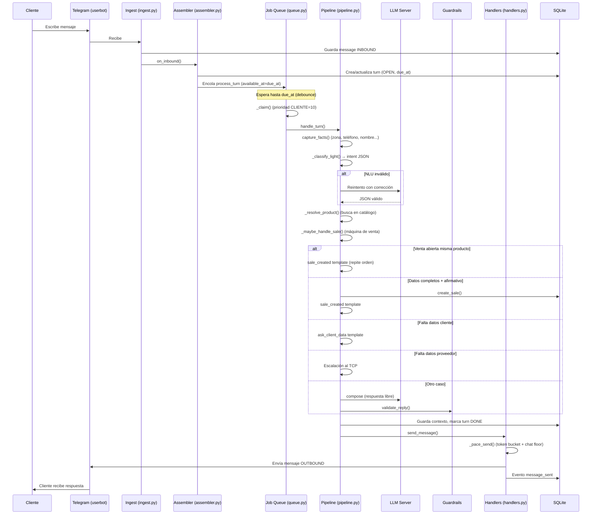

# MAPA DEL AGENTE CUADRA — Guía de entendimiento completo

**Objetivo de este documento:** Que cualquier persona (incluido el agente de IA) entienda cómo funciona Cuadra de cabo a rabo, sin lagunas, para poder modificar, depurar o extender con confianza.

**Estado:** Documento vivo. Se actualiza cuando cambia el código.

---

## 0. Índice

1. [Visión general](#1-visión-general)
2. [Arquitectura de componentes](#2-arquitectura-de-componentes)
3. [Flujo de un mensaje entrante (paso a paso)](#3-flujo-de-un-mensaje-entrante)
4. [Máquina de estados de ventas](#4-máquina-de-estados-de-ventas)
5. [Sistema de jobs y cola](#5-sistema-de-jobs-y-cola)
6. [Sistema de tiempos y pacing](#6-sistema-de-tiempos-y-pacing)
7. [NLU y clasificación de intenciones](#7-nlu-y-clasificación-de-intenciones)
8. [Generación de respuestas (templates vs LLM)](#8-generación-de-respuestas)
9. [Guardrails y validación](#9-guardrails-y-validación)
10. [TCP, escalaciones y acks](#10-tcp-escalaciones-y-acks)
11. [Base de datos (tablas clave)](#11-base-de-datos-tablas-clave)
12. [Flujo de broadcasts](#13-flujo-de-broadcasts)
15. [Diagrama de dependencias](#15-diagrama-de-dependencias)
16. [Puntos de extensión y lugares comunes de bug](#16-puntos-de-extensión-y-lugares-comunes-de-bug)

---

## 1. Visión general

Cuadra es un vendedor automatizado por Telegram (userbot) que ayuda a clientes a encontrar, comparar y comprar productos de un catálogo, coordinando con proveedores llamados **TCP** (proveedores externos con cuenta de Telegram).

**Filosofía de diseño:**
- Todo lo que sea determinista (reglas, zonas, extracción de datos) se hace en Python, no en el LLM.
- El LLM solo se usa para: clasificar intención (JSON) y redactar respuestas libres cuando las plantillas no alcanzan.
- Todo es persistente en SQLite: nada se guarda solo en RAM. Un reinicio no pierde turnos ni jobs.
- Un solo proceso por máquina (lock de archivo), para no tener dos instancias consumiendo updates de Telegram al mismo tiempo.

**Punto de entrada:** `backend/cuadra/main.py` → `lifespan()` de FastAPI.

---

## 2. Arquitectura de componentes

```
┌─────────────────────────────────────────────────────────────────┐
│                    CUADRA-CORE (un proceso)                     │
│                                                                 │
│  ┌─────────────┐  ┌──────────────┐  ┌──────────────────────┐    │
│  │  FastAPI    │  │  Job Queue   │  │   Telegram Channels  │    │
│  │  (Dashboard │  │  (workers)   │  │   userbot + bot API  │    │
│  │   + API)    │  └──────┬───────┘  └───────────┬──────────┘    │
│  └──────┬──────┘         │                      │               │
│         │                │                      │               │
│  ┌──────▼──────┐  ┌──────▼───────┐    ┌────────▼────────┐       │
│  │   Scheduler │  │   LLM server │    │  Rate limit +   │       │
│  │ (broadcasts)│  │  (llama.cpp) │    │  token bucket   │       │
│  └─────────────┘  └──────────────┘    └─────────────────┘       │
│         │                  │                     │              │
│  ┌──────▼──────┐  ┌────────▼────────┐   ┌────────▼────────┐     │
│  │   SQLite    │◄─┤  Assembler      │   │  Pipeline       │     │
│  │(persistencia│  │  (turn debounce │   │  (NLU → decide) │     │
│  │ principal)  │  └─────────────────┘   └──────┬──────────┘     │
│  └─────────────┘                               │                │
│                                                │                │
│                                         ┌──────▼──────┐         │
│                                         │  Handlers   │         │
│                                         │  (jobs)     │         │
│                                         └─────────────┘         │
└─────────────────────────────────────────────────────────────────┘
```

### Capas (de fuera hacia adentro)

| Capa | Qué hace | Archivos clave |
|------|----------|----------------|
| **Transport** | Recibe mensajes de Telegram (userbot o Bot API) | `channels/telegram_user.py`, `channels/telegram.py` |
| **Ingest** | Guarda mensaje entrante, crea o rearma turno, encola job | `ai/ingest.py` |
| **Queue** | Ejecuta jobs uno o varios workers, ordenados por prioridad | `ai/queue.py` |
| **Assembler** | Debounce: agrupa mensajes rápidos en un solo turno | `ai/assembler.py` |
| **Pipeline** | NLU → reglas → plantillas/LLM → guardrails → respuesta | `ai/pipeline.py` |
| **LLM** | Llama a llama.cpp (o compatible) para intent y compose | `ai/llm.py` |
| **Context** | Construye prompts con historial, hechos, producto en juego | `ai/context.py` |
| **Memory** | Extracción determinista de hechos (zona, teléfono, nombre...) | `ai/memory.py` |
| **Guardrails** | Valida que la respuesta no filtre precios internos, placeholders, etc. | `ai/guardrails.py` |
| **Handlers** | Ejecuta jobs concretos: send_message, send_escalation, dispatch_sale, etc. | `ai/handlers.py` |
| **Domain** | Lógica de negocio pura (sales, catalog, escalations, conversations) | `domain/` |
| **Scheduler** | Ticks periódicos: broadcast, escalaciones, conversaciones inactivas | `scheduler/` |

---

## 3. Flujo de un mensaje entrante (paso a paso)

Este es el camino crítico. Cada mensaje de un cliente sigue este camino:

```
┌─────────────────────────────────────────────────────────────────────┐
│                    FLUJO DE MENSAJE ENTrante                        │
└─────────────────────────────────────────────────────────────────────┘

PASO 1: Recepción (Telegram channel)
  └─► telegram_user.py / telegram.py recibe el mensaje
      └─► ingest.ingest_incoming() lo guarda en tabla `messages`
          └─► Si es de un proveedor conocido → va a _ingest_supplier (TCP)
              └─► Si es de cliente → crea/actualiza customer y conversation

PASO 2: Turn assembly (debounce)
  └─► assembler.on_inbound() crea o actualiza un `turn` en tabla `turns`
      └─► El turn tiene estado OPEN y un `due_at` (ahora + debounce_s)
      └─► Cada nuevo mensaje re-arma el temporizador (due_at = ahora + 0.8s)
      └─► Máximo TURN_MAX_WAIT_S (2.5s) desde el primer mensaje del burst
      └─► Se encola un job `process_turn` con available_at = due_at

PASO 3: Job queue
  └─► queue.start() lanza N workers (config.QUEUE_WORKERS=4)
      └─► Cada worker hace _claim(): toma el job PENDING con menor priority
      └─► Prioridad: CLIENTE=10, TCP=50, BROADCAST=100, MAINTENANCE=200
      └─► Mientras el userbot tenga gap activo, no se reclaman send_broadcast

PASO 4: Pipeline (procesar turno)
  └─► handlers.process_turn() ejecuta pipeline.handle_turn()
      └─► Paso 4a: NLU ligero (llm.classify_light) → intent (JSON)
      └─► Paso 4b: Resolución de producto (_resolve_product)
      └─► Paso 4c: Extracción de hechos (memory.capture_facts)
      └─► Paso 4d: _maybe_handle_sale (máquina de estados de venta)
      └─► Paso 4e: _decide (generar respuesta: template o LLM libre)
      └─► Paso 4f: Guardrails (validar respuesta)
      └─► Paso 4g: Guardar contexto y marcar turn como DONE

PASO 5: Envío
  └─► handlers.send_message() envía por Telegram
      └─► Antes: _pace_send() (token bucket + per-chat floor)
      └─► rate_limit.consume_token() → si no hay tokens, RateLimited (reintenta)
      └─► rate_limit.chat_floor_remaining() → 1s mínimo entre mensajes al mismo chat
      └─► mark_action() registra el envío
      └─► Evento 'message_sent' en tabla `events`

PASO 6: Post-envío
  └─► Si hay escalación pendiente → encola send_escalation
  └─► Si hay venta creada → encola dispatch_sale
```

### Diagrama de secuencia detallada



---

## 4. Máquina de estados de ventas

Cada venta pasa por estos estados:

```
DRAFT → PENDING_APPROVAL → PENDING_DISPATCH → DISPATCHED → CONFIRMED → DELIVERED → SETTLED
                                                  ↘
                                                   NEEDS_OPERATOR
                                                  ↘
                                                   CANCELLED
```

### Estados y significado

| Estado | Significado | ¿Quién lo cambia? |
|--------|-------------|-------------------|
| `DRAFT` | Borrador (no usado en flujo autónomo) | — |
| `PENDING_APPROVAL` | Espera aprobación del operador (modo asistido) | `sales.approve()` |
| `PENDING_DISPATCH` | Creada, lista para despachar al TCP | `create_sale()` con modo autonomous |
| `DISPATCHED` | Enviada al TCP, esperando ACK | `mark_dispatched()` |
| `CONFIRMED` | TCP confirmó recepción (RECIBIDO) | `confirm()` vía `apply_tcp_ack()` |
| `DELIVERED` | TCP confirmó entrega (ENTREGADO) | `deliver_or_flag()` vía `apply_tcp_ack()` |
| `SETTLED` | Comisión liquidada | `settle()` |
| `CANCELLED` | Cancelada | `cancel()` |
| `NEEDS_OPERATOR` | TCP reportó problema (AGOTADO) | `mark_needs_operator()` |

### Transiciones clave (en `domain/sales.py`)

```
create_sale()          → PENDING_DISPATCH (modo autonomous)
                         → PENDING_APPROVAL (modo asistido)

approve()              → PENDING_DISPATCH (desde PENDING_APPROVAL)

mark_dispatched()      → DISPATCHED (desde PENDING_DISPATCH)
                         + envía tcp_order al proveedor

apply_tcp_ack()        → CONFIRMED (desde DISPATCHED, si RECIBIDO)
                         → DELIVERED (desde DISPATCHED, si ENTREGADO)
                         → NEEDS_OPERATOR (desde DISPATCHED, si AGOTADO)
                         → AMBIGUOUS (si hay varias DISPATCHED y no hay V-#####)

confirm()              → CONFIRMED
deliver_or_flag()      → DELIVERED
mark_needs_operator()  → NEEDS_OPERATOR

cancel()               → CANCELLED
settle()               → SETTLED
```

### `_ack_sale()` — cómo se elige qué venta confirma un ACK

Cuando un TCP escribe "RECIBIDO" sin código de orden:

1. Busca ventas del proveedor con estado `DISPATCHED` (solo DISPATCHED, nunca CONFIRMED)
2. Si hay exactamente 1 → la confirma
3. Si hay 0 → retorna None (no hay nada que confirmar)
4. Si hay 2+ → retorna `AMBIGUOUS` (no adivina, se debe revisar manualmente)

**Nota:** Antes de la corrección P0, buscaba entre `DISPATCHED` y `CONFIRMED` y elegía la más antigua por `id`, lo que causaba que acks se aplicaran a ventas ya confirmadas.

---

## 5. Sistema de jobs y cola

### `ai/queue.py`

Un solo worker loop (`_loop()`) por instancia, pero se pueden lanzar varios workers (`QUEUE_WORKERS=4`).

**Prioridades (menor número = primero):**

| Prioridad | Valor | Qué usa |
|-----------|-------|---------|
| CLIENTE | 10 | process_turn, send_message |
| TCP | 50 | send_escalation, dispatch_sale, notify_tcp_cancel |
| BROADCAST | 100 | send_broadcast |
| MAINTENANCE | 200 | reindex_all_products |

**Ciclo del worker:**
1. Verificar gap del userbot (token bucket)
2. Reclamar job PENDING con menor prioridad y `next_retry_at <= ahora`
3. Ejecutar handler del job
4. Marcar COMPLETED o reintentar

**RateLimited (penalize=False):** Cuando el token bucket está vacío, el job se devuelve a PENDING con `next_retry_at` en el futuro. No consume intentos ni cuenta como fallo.

**RateLimited (penalize=True):** FloodWait real de Telegram. Consume intentos, después de `QUEUE_RATE_LIMIT_MAX_HITS` (20) marca FAILED.

---

## 6. Sistema de tiempos y pacing

Hay **tres esperas distintas** que no deben confundirse:

### 6.1 Debounce del turno (`config.py`)

```
TURN_DEBOUNCE_S = 0.8    # silencio requerido antes de procesar
TURN_MAX_WAIT_S = 2.5    # techo duro desde el primer mensaje del burst
```

Cada mensaje del cliente re-arma el temporizador a `ahora + 0.8s`. Si pasan 2.5s desde el primer mensaje del burst, se procesa aunque siga escribiendo.

**No es "espero 0.8s fijo".** Es "espero 0.8s de silencio".

### 6.2 Token bucket del userbot (`channels/rate_limit.py`)

Reemplaza el antiguo gap fijo de 8s.

```
USERBOT_TOKEN_BUCKET_CAPACITY = 4    # ráfaga de 4 mensajes sin esperar
USERBOT_TOKEN_BUCKET_REFILL_S = 1.5  # 1 token cada 1.5s (~40/min teórico)
USERBOT_MAX_MSG_PER_MIN = 20         # tope duro
USERBOT_MAX_MSG_PER_HOUR = 300       # tope horario
PER_CHAT_MIN_GAP_S = 1.0             # mínimo entre 2 mensajes al mismo chat
```

### 6.3 Delay humano (eliminado en P0)

Antes: `TYPING_DELAY` (1-4s) y `OUT_OF_HOURS_DELAY` (5-15s). Ahora ambos son 0. No hay simulación de escritura.

### 6.4 Scheduler (ticks periódicos)

| Tick | Intervalo | Qué hace |
|------|-----------|----------|
| broadcast | 5s | Dispatch una post por campaña por tick |
| escalation timeout | 120s | Revisa escalaciones sin respuesta |
| purge LLM traces | 24h | Borra trazas de LLM antiguas |
| close idle conversations | 24h | Cierra conversaciones sin actividad |
| queue sale followups | 15min | Rearma seguimientos de ventas |

---

## 7. NLU y clasificación de intenciones

### `ai/llm.py` — `classify_light()`

Usa un prompt mínimo (~600 tokens) en lugar del system prompt completo (~2171 tokens).

**Esquema de salida (JSON):**

```json
{
  "intencion": "consulta_precio|consulta_stock|consulta_dato|comparar|comprar|queja|otro",
  "producto": "nombre o null",
  "datos_faltantes": ["lista de datos que faltan"],
  "confianza": 0.0-1.0,
  "cantidad": null|1|2|3...
}
```

**Intenciones:**
- `consulta_precio`: pregunta cuánto cuesta
- `consulta_stock`: pregunta si hay disponible
- `consulta_dato`: pide un detalle (garantía, zona, medida)
- `comparar`: compara productos
- `comprar`: quiere cerrar compra
- `queja`: reclama o está molesto
- `otro`: saludo, charla, tema ajeno

### `llm.classify()` (versión completa)

Usa el system prompt completo + NLU_TASK. Solo se usa si `classify_light` falla o en casos específicos.

---

## 8. Generación de respuestas

Dos caminos:

### 8.1 Templates (plantillas deterministas)

Para casos comunes (saludo, precio, stock, falta de datos, venta creada). Definidos en `ai/prompts.py:TEMPLATES`.

Algunas tienen variantes (anti-repetición) en `TEMPLATE_VARIants`:
- `greeting_product` (3 variantes)
- `ask_which_product` (3 variantes)
- `ask_client_data` (3 variantes)
- `fallback_product` (3 variantes)

Selección: `template_variant(name, context, **kwargs)` recuerda la última usada en `context[f"last_template_{name}"]` y evita repetirla.

### 8.2 LLM libre (`llm.compose()`)

Para casos no cubiertos por plantillas (comparar, queja, otro, low confidence). Usa `COMPOSE_INSTRUCTION` + historial + producto en juego.

Validado por `guardrails.validate_reply()` antes de enviar. Si falla, reintenta con `GUARDRAIL_CORRECTION`. Si falla otra vez, usa `fallback_reply()`.

---

## 9. Guardrails y validación

`ai/guardrails.py` — `validate_reply(reply, context)` devuelve `(ok, reason)`:

| Check | Qué valida | Código de fallo |
|-------|-----------|-----------------|
| `check_format` | Sin JSON, sin código, sin headings | `"format"` |
| `check_length` | ≤900 chars, ≤N párrafos, ≤N líneas | `"length"` |
| `check_internal_terms` | No menciona comisiones, márgenes, costos internos | `"internal_terms"` |
| `check_no_internal_placeholders` | No deja `[precio anterior]`, `[DIR]`, `[TEL]`, `[NOMBRE]` | `"internal_placeholder"` |
| `check_prompt_disclosure` | No repite el system prompt | `"prompt_disclosure"` |
| `check_prices` | Todo precio mencionado está en el catálogo permitido | `"price"` |

Si falla: reintenta con corrección. Si falla otra vez: `fallback_reply()` (template determinista).

---

## 10. TCP, escalaciones y acks

### Flujo de escalación

```
Cliente pregunta dato del proveedor
    │
    ▼
Pipeline clasifica consulta_dato con datos_faltantes
    │
    ├─► Si son datos del cliente (zona, tel, nombre) → ask_client_data (no escala)
    │
    ├─► Si son datos del proveedor (stock, garantía) → escalar
    │     │
    │     ▼
    │   escalations.create() → estado PENDING
    │     │
    │     ▼
    │   send_escalation job → envía mensaje al TCP con pregunta real
    │     │
    │     ▼
    │   TCP responde (ej. "Es Marianao")
    │     │
    │     ▼
    │   tcp_triage.correlate() → busca escalación abierta del proveedor
    │     │
    │     ▼
    │   tcp_process() → resume_escalations() → notifica a clientes
    │     │
    │     ▼
    │   escalations.set_tcp_answer() → estado RESOLVED
```

### Acks de ventas (TCP confirma recepción/entrega)

Flujo en `handlers.tcp_process()`:

1. `parse_case_ids()` → si hay `[V-000001]`, busca esa venta directamente
2. Si no hay código, `sales_domain.apply_tcp_ack()`:
   - Busca ventas `DISPATCHED` del proveedor
   - Si 1 → confirma
   - Si 0 → ignora
   - Si 2+ → `AMBIGUOUS` (no adivina, evento para operador)
3. `RECIBIDO/RECIVIDO/CONFIRMADO/LISTO` → `CONFIRMED`
4. `ENTREGADO/COBRADO` → `DELIVERED`
5. `AGOTADO/SIN STOCK` → `NEEDS_OPERATOR`

**Reglas de seguridad (P0):**
- Solo `DISPATCHED` (nunca `CONFIRMED`) para evitar doble confirmación
- Si hay `V-#####` en el texto, se honra aunque falle la regex de ack
- `AMBIGUOUS` se registra y avisa al operador, nunca silencio

---

## 11. Base de datos (tablas clave)

Todas en `backend/data/cuadra.db` (SQLite, WAL mode).

| Tabla | Qué guarda | Columnas clave |
|-------|-----------|----------------|
| `suppliers` | Proveedores/TCP | id, name, telegram_id, telegram_peer_id, active |
| `conversations` | Conversaciones | id, customer_id, channel, status, context_json, created_at |
| `customers` | Clientes | id, name, preferences_json |
| `messages` | Todos los mensajes | id, conversation_id, direction, author, type, body, latency_ms, created_at |
| `turns` | Turnos (debounce) | id, conversation_id, status, due_at, job_id, message_ids_json |
| `jobs` | Cola de trabajo | id, type, payload_json, priority, status, next_retry_at, attempts |
| `sales` | Ventas | id, order_code, product_id, quantity, amount, status, delivery_zone, delivery_address, customer_phone, recipient_name, created_at, dispatched_at, tcp_ack_at |
| `products` | Catálogo | id, supplier_id, name, price, currency, stock, status, category_id |
| `zones` | Zonas de entrega | id, name, active |
| `escalations` | Escalaciones a TCP | id, conversation_id, product_id, supplier_id, question, status, tcp_answer |
| `events` | Log de eventos | id, source, type, entity, entity_id, details_json, created_at, category |
| `llm_calls` | Trazas de LLM | id, purpose, latency_ms, ok, error, prompt_tokens, output_tokens |
| `sender_state` | Estado de rate limit | sender, last_action_at, blocked_until, reason |
| `broadcasts` | Campañas | id, name, status, min_interval_s, max_posts_per_day |
| `broadcast_posts` | Posts de campaña | id, broadcast_id, sent_text, status, attempts |

---

## 13. Flujo de broadcasts

```
Scheduler (tick cada 5s)
    │
    ▼
due_broadcasts() → campañas con next_send_at <= ahora
    │
    ▼
send_broadcast job → para cada grupo objetivo:
    │
    ├─► _check_token_bucket() (si es userbot)
    │   ├─► Si no hay tokens → RateLimited (reintenta después)
    │   └─► Si hay tokens → continuar
    │
    ├─► Enviar mensaje/imagen al grupo
    │
    └─► record_result(post_id, "SENT" o "FAILED")
```

Cada grupo tiene `min_interval_s` y `max_posts_per_day` para evitar spam.

---

## 15. Diagrama de dependencias (código)

```
main.py
├── config.py (todo configurable por env var)
├── db.py (SQLite, migraciones)
├── instance.py (lock de archivo)
│
├── ai/
│   ├── queue.py (workers, jobs, RateLimited)
│   ├── assembler.py (turn debounce)
│   ├── pipeline.py (NLU → decide → respuesta)
│   ├── llm.py (cliente llama.cpp, classify_light, classify, compose)
│   ├── context.py (construcción de prompts)
│   ├── memory.py (extracción determinista de hechos)
│   ├── guardrails.py (validación de respuestas)
│   ├── handlers.py (ejecución de jobs: send_message, tcp_process, etc.)
│   ├── tcp_triage.py (correlación de mensajes TCP)
│   ├── retrieval.py (búsqueda de productos: FTS + embeddings)
│   └── prompts.py (system prompt, templates, variants)
│
├── domain/
│   ├── sales.py (máquina de estados, create_sale, apply_tcp_ack, update_sale_quantity)
│   ├── catalog.py (resolve_zone, list_zones, supplier_delivery_zones)
│   ├── conversations.py (CRUD conversaciones, context_json)
│   ├── escalations.py (CRUD escalaciones)
│   ├── turns.py (máquina de estados de turnos)
│   └── events.py (log de eventos)
│
├── channels/
│   ├── telegram_user.py (userbot, send_message, typing)
│   ├── telegram.py (Bot API)
│   └── rate_limit.py (token bucket, chat floor, cooldowns)
│
└── scheduler/
    ├── broadcasts.py (tick de campañas)
    └── __init__.py (scheduler de APScheduler)
```

---

## 16. Puntos de extensión y lugares comunes de bug

| Zona | Qué puede fallar | Qué revisar |
|------|-----------------|-------------|
| `resolve_zone()` | Nombres cortos (Regla=5 chars) dan falso positivo con palabras comunes | `_ZONE_HINT_RE` o longitud mínima |
| `_ack_sale()` | Acks a venta equivocada o doble confirmación | Solo `DISPATCHED`, honrar `V-#####`, manejar `AMBIGUOUS` |
| `_maybe_handle_sale()` | Bucle post-venta (repite misma venta) | Comparar `product_id` antes de cortocircuito |
| `_classify_light()` / `classify()` | Escalación con slot crudo ("municipio") | Clasificar datos cliente vs proveedor, no escalar datos del cliente |
| `template_variant()` | Repetición de plantilla | Verificar `last_template_*` en contexto |
| `apply_tcp_ack()` | Acks ambiguos sin respuesta al TCP | Siempre responder al TCP, registrar AMBIGUOUS |
| `_pace_send()` / token bucket | Mensajes perdidos o ban por exceso | Verificar `consume_token()` y `chat_floor_remaining()` |
| `capture_facts()` | Dirección no capturada (sin etiqueta) | `_ADDRESS_FLEXIBLE` regex |
| `turns.upsert_open_turn()` | Turnos duplicados o mensajes perdidos | `claim()` atómico, `recover_open()` en startup |

---

## 17. Glosario

| Término | Significado |
|---------|-------------|
| TCP | Proveedor externo (proveedor de producto) con cuenta de Telegram |
| Turn | Un burst de mensajes del cliente que debe producir una sola respuesta |
| Debounce | Espera de silencio antes de procesar un turno |
| Job | Unidad de trabajo en la cola persistente (`jobs` table) |
| ACK | Acknowledgement del TCP (RECIBIDO, ENTREGADO, AGOTADO) |
| Escalación | Pregunta del cliente que el bot no puede responder y debe pedir al TCP |
| Guardrail | Validación de seguridad en la respuesta antes de enviarla al cliente |
| Token bucket | Sistema de pacing que permite ráfagas pero limita tasa a largo plazo |

---

*Fin del mapa del agente.*
